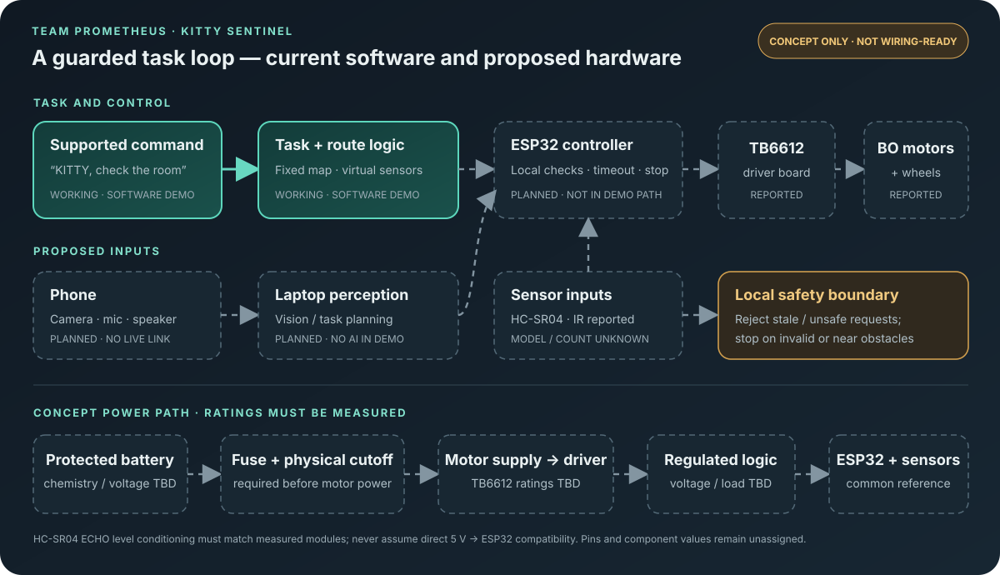

# KITTY Sentinel — Team Prometheus

**Hack in Hills ’26 · Vision-Based Autonomous Robot · HACK IN HILLS HACKATHON.**

KITTY is a proposed indoor companion robot for simple hands-busy tasks. In the current software demo, a supported room-check command starts a simulated route; the rover pauses and gives a virtual buzzer warning near an obstacle, then plans a detour. The robot does not yet understand open-ended speech, see through a live camera, or drive from this software.

> **Pitch:** We help people with hands-busy tasks by turning a supported room-check command into a guarded, obstacle-aware robot task.

**Team:** Virat Anand (leader), Sarthak Suman, and Rida Fatima.

## Try the interactive demo

Open [`software/room-check-demo/index.html`](software/room-check-demo/index.html) in a modern browser. Enter **“KITTY, check the room”** and select **Run task**. The animated simulation shows the command, virtual scan, obstacle pause and buzzer, route detour, and task completion. Pause, resume, reset, stop, and optional sound are available. No install, network, account, API key, or hardware is needed.

This demo uses a fixed software test map. Its virtual sensors and buzzer are not physical readings or outputs, and its planned route has access to the supplied map. There is no destination picker.

## What works today

- A browser-based, command-driven software simulation with a repeatable room-check task.
- Deterministic route planning and a guarded simulated motion loop.
- A virtual obstacle warning, stop, beep, detour, completion, and STOP command.
- A separate earlier grid-navigation simulator in [`software/simulator/`](software/simulator/); it is retained as an exploratory baseline, not the current command demo.

The team reports that the physical base was tested. That is a team-reported result; this repository's automated checks exercise software only. Full assembly and sensor-to-motor integration are not established here.

## System at a glance



The software demo is local and simulated. A phone camera/microphone, laptop perception/planning, and an ESP32 safety controller are proposed integration steps. The ESP32 is intended to retain local authority over movement; model-generated text must never map directly to motor pins.

See [`docs/CIRCUIT-AND-SYSTEM.md`](docs/CIRCUIT-AND-SYSTEM.md) for the circuit/power architecture, reported parts, open measurements, and why the draft is not wiring-ready. No GPIO assignment is published because exact board variants, sensor count, power source, and ratings have not been verified.

## Run checks

From the repository root:

```bash
python -m unittest discover -s software/simulator/tests -v
node software/room-check-demo/test-command.cjs
```

The GitHub Actions workflow runs both suites on pushes and pull requests. These checks do not flash a board, energize motors, or verify physical behavior.

## Project notes

- [Build status and verified claims](docs/BUILD-STATUS.md)
- [Reported parts and what remains unknown](docs/ACTUAL-PARTS-REPORTED.md)
- [Circuit and system architecture](docs/CIRCUIT-AND-SYSTEM.md)
- [Animated room-check demo](software/room-check-demo/README.md)
- [Earlier navigation simulator](software/simulator/README.md)
- [Appearance proposal and model plan](design/r2/DESIGN-BRIEF.md) · [`models/README.md`](models/README.md)

Phone AI, live camera processing, speech recognition, physical sensor transport, final body fit, and flight are not represented as working features. The wheel-to-rotor idea is a separate, unbuilt V2 concept and is not part of this prototype.

No third-party runtime packages or model weights are bundled. No software license has been selected; preserve the original license terms for any future dependency or model.

