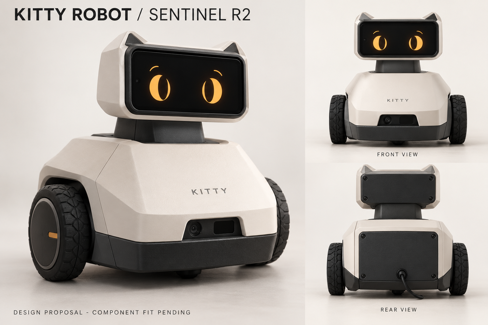

# KITTY ROBOT

**HACK IN HILLS HACKATHON.**

Kitty Sentinel by Team Prometheus: an indoor vision-guided wheeled robot, designed to identify a supported target, approach it through a guarded controller and stop when observations or communication become unreliable.

Team: **Virat Anand (leader), Sarthak Suman, Rida Fatima.**

## Current state — 23 October 2026

The laptop simulator works and has 10 passing unit tests. The user reports purchasing electronics; exact parts/measurements and physical operation are not yet verified. User-reported hardware baseline: ESP32 + TB6612 + BO motors/wheels + HC-SR04, with OPPO A57 as phone; variants and fit remain pending. Real camera ingestion, target recognition, hardware bridge and physical navigation remain to be implemented. The R2 design image is an appearance proposal, **not final fitted CAD or a photograph of built hardware**.



## Run the simulator

Python 3.10+ standard library is enough:

```text
cd software/simulator
python main.py
```

Open the actual localhost URL printed in the terminal. The operating system chooses a free port. Motors, map, position and range readings are simulated. No hardware or API account is required. Tests: `python -m unittest discover -s tests -v` from that same folder.

## New development workbench

`software/kitty/` adds an animated KITTY face, offline personality replies and a guarded mission preview. From that directory run `python main.py` (Windows: `py -3 main.py`) and use the printed local address. All observation inputs are explicitly labelled developer fixtures; physical motor output is disabled and no hardware transport exists. See `software/kitty/README.md` for the preview tests and limits.

Start real component intake with `docs/BENCH-START.md`. Current reported parts and unresolved power requirements are in `docs/ACTUAL-PARTS-REPORTED.md`. `design/r2/cad/` contains the parameterized STL/STEP framework; example exports are drafts and measured input is intentionally incomplete. No fitted R2 print release or physical test is claimed.

## Proposed real system

Phone camera → laptop target detector/tracker → deterministic mission/guard → explicitly enabled ESP32 adapter → correctly rated motor driver → wheels. Real range sensor and local output timeout constrain motion. Physical motor-power cutoff remains reachable. Optional conversation has no direct motor authority.

## Design and models

- `design/r2/DESIGN-BRIEF.md`: body direction, serviceability and dimensions still needed before final STL.
- `docs/MODEL-CHOICE.md`: Qwen3.5-2B starting recommendation, larger model only after laptop benchmark; detector benchmark plan.
- `prompts/kitty-personality.txt`: original prompt for a concise, witty, truthful assistant.
- `models/Modelfile`: optional local Ollama personality profile; weights are not bundled or downloaded.
- `docs/BUILD-STATUS.md`: what remains before physical demonstration.

The profile is prepared, not a trained model or a benchmarked hardware integration. A repository stores/version-controls the project; the robot program runs on its laptop/controller. A website/CI job cannot replace that real-time control loop.

## Development checks

The included GitHub Actions workflow runs simulator tests on pushes and pull requests. It does not deploy motor control, download model weights, use API keys or flash hardware. No public hosted robot service exists.

Private registration/TinyFish proofs, account credentials, local environments and unrelated Kitty Corp applications are excluded. A license for this repository has not yet been selected; preserve upstream model/software license terms when integrating dependencies.
